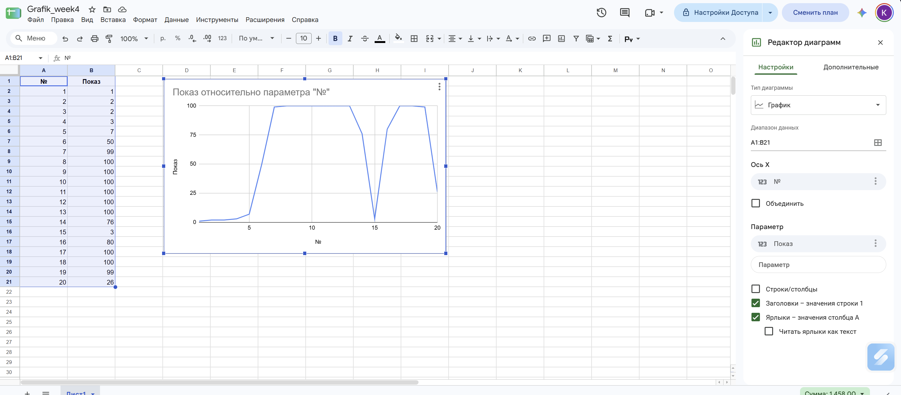

| №  | Де був робот      | Показ |
|----|-------------------|-------|
| 1  | На лінії          | 1     |
| 2  | На лінії          | 2     |
| 3  | На лінії          | 2     |
| 4  | На лінії          | 3     |
| 5  | На лінії          | 7     |
| 6  | На краю лінії     | 50    |
| 7  | Біла підлога      | 99    |
| 8  | Біла підлога      | 100   |
| 9  | Біла підлога      | 100   |
| 10 | Біла підлога      | 100   |
| 11 | Біла підлога      | 100   |
| 12 | Біла підлога      | 100   |
| 13 | Біла підлога      | 100   |
| 14 | На краю лінії     | 76    |
| 15 | На лінії          | 3     |
| 16 | На краю лінії     | 80    |
| 17 | Біла підлога      | 100   |
| 18 | Біла підлога      | 100   |
| 19 | Біла підлога      | 99    |
| 20 | На краю лінії     | 26    |

**Найменший показ: 1**  
**Найбільший показ: 100** 

## Графік

